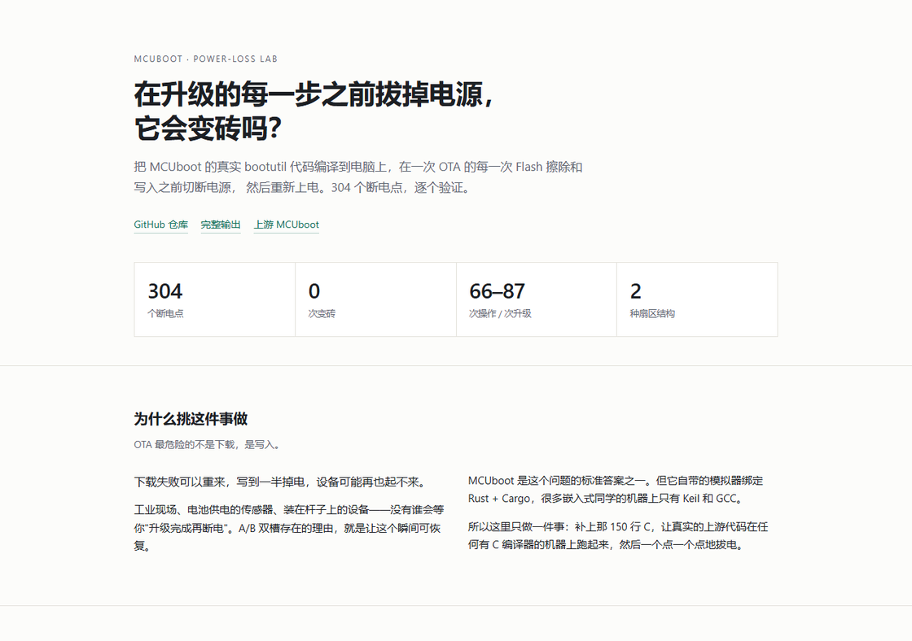

# mcuboot-powerloss-lab

把 [MCUboot](https://github.com/mcu-tools/mcuboot) 的**真实 `bootutil` 源码**编译到 PC 上，在一次 OTA 升级的每一次 Flash 擦除/写入之前切断电源，验证设备重新上电后能否恢复。

不依赖 Rust，不需要开发板，只需要一个 C 编译器。

**结果：304 个断电点，0 次变砖。**



| 场景 | 扇区 | 一次完整流程的操作数 | 断电点 | 失败 |
|---|---|---|---|---|
| 永久升级 1.0.0 → 1.1.0 | 4 KB | 66 | 66 | 0 |
| 测试模式回滚 1.1.0 → 1.0.0 | 4 KB | 65 | 65 | 0 |
| 永久升级 1.0.0 → 1.1.0 | 1 KB | 87 | 87 | 0 |
| 测试模式回滚 1.1.0 → 1.0.0 | 1 KB | 86 | 86 | 0 |
| 次级槽镜像被篡改 | — | — | — | 正确拒绝，启动 1.0.0 |

完整输出见 [`docs/results.txt`](docs/results.txt)，逐条操作序列见 `build/ops.csv`。

## 为什么做这个

1. OTA 最危险的时刻不是传输，而是升级写到一半掉电。工业现场、电池供电设备都躲不开。
2. MCUboot 自带模拟器，但它绑定 Rust + Cargo，很多嵌入式同学机器上只有 Keil / GCC，跑不起来。
3. 用**真实代码**跑，而不是自己写一个"像 MCUboot"的模型——后者只能证明模型自洽，证明不了上游实现。

## 怎么做的

```
src/main.c          构造镜像、扫描断电点、断言结果
      │
      ▼
boot/bootutil/*.c   ← 上游 MCUboot，未修改
      │
      ▼
run.c               ← 上游模拟器自带的 C 胶水层，未修改
      │  调用 sim_flash_read / write / erase
      ▼
port/sim_port.c     ← 本仓库实现：256 KB RAM Flash + 扇区表
```

上游的 `run.c` 已经用 `setjmp/longjmp` 实现了"数到第 N 次 Flash 操作就跳出去"的机制，缺的只是它默认把这一层交给 Rust。补上 `sim_*` 这一组函数（约 150 行），整个 bootloader 就能在 PC 上跑。

**断电语义**：与上游模拟器一致——命中计数的那次操作**不会执行**，等价于"在第 N 次擦写之前掉电"。

## 构建

```bash
git submodule update --init third_party/mcuboot
git -C third_party/mcuboot submodule update --init ext/mbedtls-3.6.0

make            # 或 CC="zig cc" ./build.sh
./build/powerloss-lab
```

Windows 上没有 `make` 时：

```bash
CC="zig cc" ./build.sh
```

## 检查了什么

每个断电点都断言三件事：

1. **能启动**：`boot_go()` 返回 0，且启动的是预期版本（升级场景是 1.1.0，回滚场景是 1.0.0）。
2. **槽内容正确**：slot 0 的镜像头是预期版本，不是半张镜像。
3. **不会反复倒腾**：紧接着再启动一次，Flash 写入次数必须为 0——否则说明设备会每次开机都重新交换，这是 A/B 方案里典型的隐蔽 bug。

## 为什么每个点都能恢复

看 `build/ops.csv` 会发现规律：每搬完一个扇区，bootloader 先往 swap status（scratch 或槽尾）写 8 字节进度，再动下一块数据。

```
erase scratch → copy 4 KB → write status(8 B) → erase slot1 → copy 4 KB → write status(8 B) → ...
```

所以任意时刻掉电，Flash 上留下的都是一个**自洽的中间态**：要么"第 k 块已搬完"，要么"第 k 块没开始"。重启后读回 status，从 k 继续，不需要额外日志。

66 次操作里：36 次是 1 KB 数据搬运，16 次写 8 字节状态，2 次写 16 字节标记，12 次是 4 KB 擦除。真正干活的只有那 36 次，其余都是"记账"。

## 边界（没做什么）

- 只测**未签名镜像**（校验 SHA256）。加签名要引入 tinycrypt/mbedTLS 的 ECDSA 路径，属于另一组场景。
- 只覆盖 **swap-scratch**，没有覆盖 swap-move / overwrite-only / direct-XIP。
- RAM 模拟不模拟 NOR 的位翻转、坏块、写放大、真实擦除时间。
- 这是**验证实验台**，不能替代真机的高低温、掉电时序和老化测试。

## 许可

Apache-2.0。`third_party/mcuboot` 及其子模块版权归 MCUboot 作者所有。
